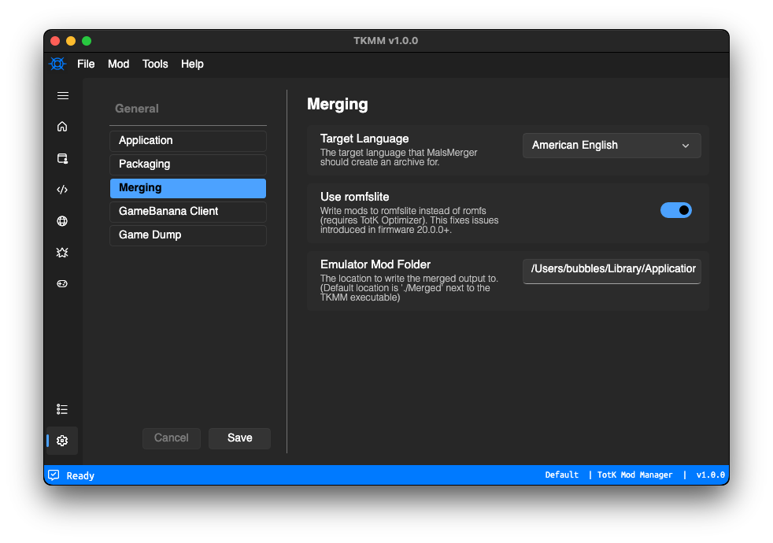
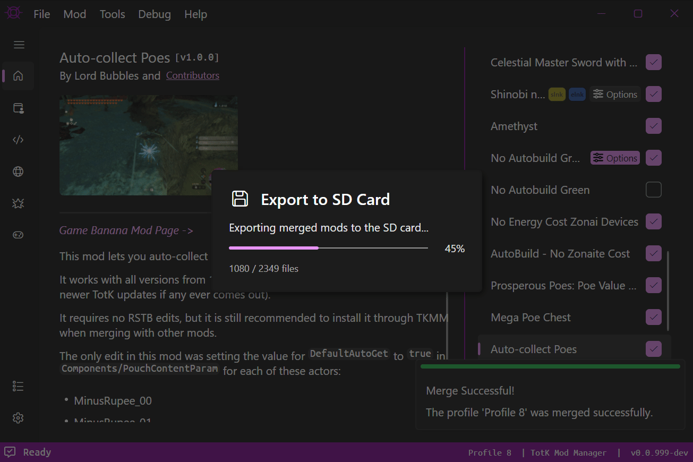
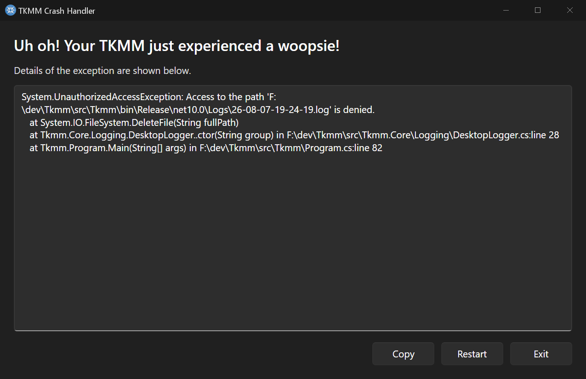
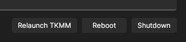

# TKMM v2.2.0: Full Changelog

Download from the [official website](https://tkmm.org/downloads/) or use the in-app updater.

**Full GitHub history since last update**: [v2.1.0...v2.2.0](https://github.com/TKMM-Team/Tkmm/compare/v2.1.0...v2.2.0)

## Changes

- Builds of Tkmm.CLI are now included in the releases to assist with the automation of mod packaging / installing, or for use with tools like TKVSC.
- Implemented BNTX merging (this also has the side benefit of making old UI edits work on newer versions of the game).
- Implemented BFRES cleanup: materials that are not assigned to any object on the models will be removed (on packaging for mods built with this version, and on merge for older mods). The game loads all textures even if their associated materials are unused, which increases memory use and may cause blood moon panics.
- It is now possible to define resource table overrides when packaging a mod from the Projects page (e.g., when TKMM's estimated bfres values are too high or too low for specific files in your mod) - contribution from [MediaMoots](https://github.com/MediaMoots).
- It is now possible to define which options should be enabled by default when packaging TKCL files.
- Added support for merging all locales (this option is mainly for mod creators, and therefore hidden under "Advanced settings").
- Duplicate subsdk files with the same hash will now be skipped upon merging - contribution from [Mindstormman06](https://github.com/Mindstormman06).
- TKMM will now warn you when run from a temporary folder (e.g. launched from inside the release zip) and explain why that is unsupported; the only option is to close the app.
- Actually implemented Auto-Save for the settings (the toggle existed, but did nothing). Saving only triggers upon text fields losing focus, or upon toggle/dropdown state changes.
- When the total amount of .ainb files inside `Pack/AI.Global.Product.pack` exceeds the hard limit of 1980, TKMM will increase that limit to the exact number required (defined within the `HeapDef` file).

## Fixes

- Fixed GameDataList deleted bool64bitkeys using the wrong data type for the hash - contribution from [Echocolat](https://github.com/Echocolat).
- Fixed exefs files named like `1.2.1.pchtxt` being interpreted as versioned romfs files.
- Fixed the UI freezing for a few seconds after pressing the Apply button.
- Fixed large mods failing to install to TKMM on FAT32 file systems due to the limit of files per folder (the `romfs` changelogs will now be stored in buckets of maximum 3000 files per folder, same as RomfsLiteEX when merging).
- Fixed files from previous install not being deleted after updating or reinstalling a mod with the same ULID.
- Fixed TKCL mod metadata being overwritten with GameBanana submission when installed from the GB browser (title, thumbnail, description... etc.).
- Fixed a very old updater issue that has been haunting us for months because we kept misdiagnosing the root cause: after the executable had renamed itself, it was failing to find the library containing the Process.Start() method to launch the new executable. It is now ensured that the method is loaded into memory using runtime helpers before the executable renames itself.
- Fixed an issue with jittery scroll on the Logs page. Log entries are now capped to one line by default and expand to their full size when selected.
- Fixed an issue where changes to the merge output field in settings would apply instantly at every single character edit when manually typing. Changes to that field are now only applied when explicitly saving (or with Auto-Save when the text field is no longer in focus).
- Fixed an issue with the Inter font not being properly applied, resulting in missing characters on the UI with some Linux distros.
- Fixed installing mods via drag and drop resulting in the stream being disposed too early.

## TotK Optimizer

- Updated the integrated TotK Optimizer (Ultracam) to version 3.5.0 (now compatible with TotK 1.4.3).
- This new version adds RomfsLiteEX support, which, when enabled, will result in romfs buckets of 3000 files per folder in the merge output. This bypasses issues on FAT32 SD cards related to the limit of files per folder.
- Changes to the Ultracam configuration made from within the in-game menu will now be loaded by TKMM to avoid overwriting these changes every time mods are applied.

This version of the optimizer is still experimental on versions 1.4.0 and higher, and will be updated at a later date.

Here are the known issues so far:
- 6GB memory layout doesn't work on emulators (use 8GB instead).
- The map cuts off on 1.4.3 when using higher aspect ratios.
- The Switch applet keyboard on the Ultracam in-game menu crashes on 1.4.X

## Full macOS support

Prior macOS builds of TKMM required running some commands in a bash terminal to sign the executable, and launch it. None of us owned a Mac, so we couldn't test it, or figure out how to properly package it, or even add basic support for multiple features.

We still don't own Macs, but thanks to VMWare and a bit of tinkering, we were able to implement a new workflow to properly package TKMM for macOS.

On v2.2.0, this changes:
- macOS builds will now be published as app bundles and .dmg files
- updater support was added and fully tested
- implemented `.tkcl` file association
- added `tkmm://` URI handler support
- fixed auto emulator setup
{: .compact-list}

**IMPORTANT NOTE**: To transfer your mod profiles from versions prior to v2.2.0 on macOS, move the `.data2` folder to `~/Library/Application Support/tkmm2` (previously stored next to the `Tkmm` executable file).

  

## User Experience Improvements

- Implemented updater support for AppImage builds.
- Implemented `tkmm://` URI handler support, as well as `.tkcl` file association for most Linux distros. An icon theme installer was also added to show the TKMM logo for the application on the task bar, and `.tkcl` archives in the file explorer. Please [report it](#bug-reporting) if your distro wasn't properly covered.
- Added a `Re-run Setup Wizard` tool which can be used if you want to set up TKMM for another emulator. This exits and re-launches TKMM into the setup wizard.
- When a mod archive contains multiple TKCL files, TKMM will now show a popup allowing you to choose which one you want to install instead of only installing the first one.
- The `Export to SD card` tool will display a popup with a progress bar when copying files, and support has been added on Windows for MTP devices (e.g., when using the USB File Transfer homebrew on Switch).

   
  

## GameBanana Browser Updates

- Added the ability to browse WIPs.
- It is now possible to bookmark your favorite mods.
- Archived files will now be visible in the list of downloads on mod pages.
- Updated endpoints to require less API calls and make the browser faster.
- This API change results in the ability to use better sort modes ("New & Updated", "Most Liked", "Most Downloaded"... etc.).
- All images are now cached to make the browser faster and avoid putting too much strain on the GameBanana servers (empty with `File` > `Clear Temporary Files`).
- Images on mod pages can now be maximized into a semi-fullscreen overlay (can be navigated using the keyboard or on-screen left/right buttons).
- Added the ability to search for mods by specific members (you can now search `member:<id>`, use `tkmm://member/<id>`, or simply click a member username from the GB browser).
- Mod downloads containing a TKCL file will now appear with a **Recommended** watermark on the file list.

    <video controls>
        <source src="/img/2.2.0/gb_browser.mp4" type="video/mp4">
    </video>

## Crash Handler

A crash handler has been implemented to TKMM. When an unrecoverable exception occurs, TKMM used to crash with no indication as to why. Now, a window will open after crashing, showing the full stacktrace of the crash. This window has 3 buttons: one to copy the error, one to relaunch TKMM, and one to exit.

  

This is particularly useful for TKMM-NX, due to the various reasons why TKMM would crash (mostly related to SD card issues), sometimes failing to relaunch completely. This was resulting in situations like getting stuck on a black screen / spash image with a mouse pointer and nothing to click on.

When using TKMM-NX, the crash handler buttons differ since the application runs in a Linux sandbox with no desktop environment:

  

## Setup Wizard Improvements

- The first step of the wizard is now the application language selection. If changed from default, it will show a prompt to restart the application in order to apply the new language. 

    <video controls>
        <source src="/img/2.2.0/wizard_language_selection.mp4" type="video/mp4">
    </video>

- Implemented TKMM Modes: Emulator, Switch and Hybrid.
  - Emulator mode (default): everything will be identical to previous default behavior, the Apply button will output the merged mods to the emulator's mod folder (or a manually defined output).
  - Switch mode: the Apply button will behave like the `Export to SD card` tool.
  - Hybrid mode: the Apply button will be a dropdown with the options `Emulator` and `SD Card`.
  {: .compact-list}

- When using TKMM-NX, or the desktop version using Switch and Hybrid modes, the setup wizard will now ask if your Switch firmware is 19.x.x (or lower) or 20.x.x (or higher). This will be used to determine default settings (such as enabling the optimizer and romfslite).

- If multiple TotK versions are detected in the available dumps when going through the setup wizard (or when in Emulator mode and the exact version used by the emulator couldn't be automatically detected), a new step will now ask you to select which version to set as the preferred one.

    <video controls>
        <source src="/img/2.2.0/wizard.mp4" type="video/mp4">
    </video>

## Bug Reporting
Please report bugs in [#bug-reports](https://tkmm.org/discord) on Discord, or post a [new issue](https://github.com/TKMM-Team/Tkmm/issues/new) on GitHub.

## Contributors to this update
- [Arch Leaders](https://github.com/ArchLeaders)
- [Lord Bubbles](https://github.com/LordBubblesDev) 
- [MaxLastBreath](https://github.com/MaxLastBreath) (Ultracam / RomfsLite)
- [Aster](https://github.com/AsteroidPizza39) (gathered as many toasters as possible so we could warm the regards)
- [Echocolat](https://github.com/Echocolat) (GDL changelog fixes)
- [MediaMoots](https://github.com/MediaMoots) (RESTBL overrides)
- [Mindstormman06](https://github.com/Mindstormman06) (duplicate subsdk file check)
{: .compact-list}

## Looking for Developers

If you are interested in contributing or simply helping with the development of TKMM in general, do not hesitate to submit a PR on [GitHub](https://github.com/TKMM-Team/Tkmm), or join our [Discord server](https://tkmm.org/discord) and let us know how you think you could help.

Obviously, a decent knowledge of C# and/or general programming will be needed. TKMM is written entirely in C# and AXAML (Avalonia eXtensible Application Markup Language, for the UI).

As it stands, we do not have a lot of free time to work on this project, so the commits are pretty slow, and we would love if someone with a passion for the project would be happy to step in.

## Support the project

TKMM is a project built by a small but dedicated team who care very much about making modding Tears of the Kingdom accessible. In order to support our community, we are paying for a custom domain name and a server. 

All of these costs, are currently covered out of our own pockets. Although the cost is minimal, the ongoing expenses add up over time, and if you find this project helpful, or would just like to show appreciation for the work we do, we would sincerely appreciate your support. Even a small donation helps cover the costs of server uptime, web infrastructure, and allows for further improvements, new features, and better reliability.

Additionally, we need your help so that Aster can keep buying toasters. We intend to buy all the toasters in the world to make our regards as warm as possible, at each and every announcement.

If you would like to help sustain the project, or simply say "thank you" to the developers, we have reopened our [Ko-Fi](https://ko-fi.com/tkmmteam) and [Patreon](https://www.patreon.com/tkmmteam) for donations. Your support directly encourages further development. We are deeply grateful for any and all contributions, no matter the amount. Thank you for being part of our community!

*Warmest regards,* *The TKMM Team*